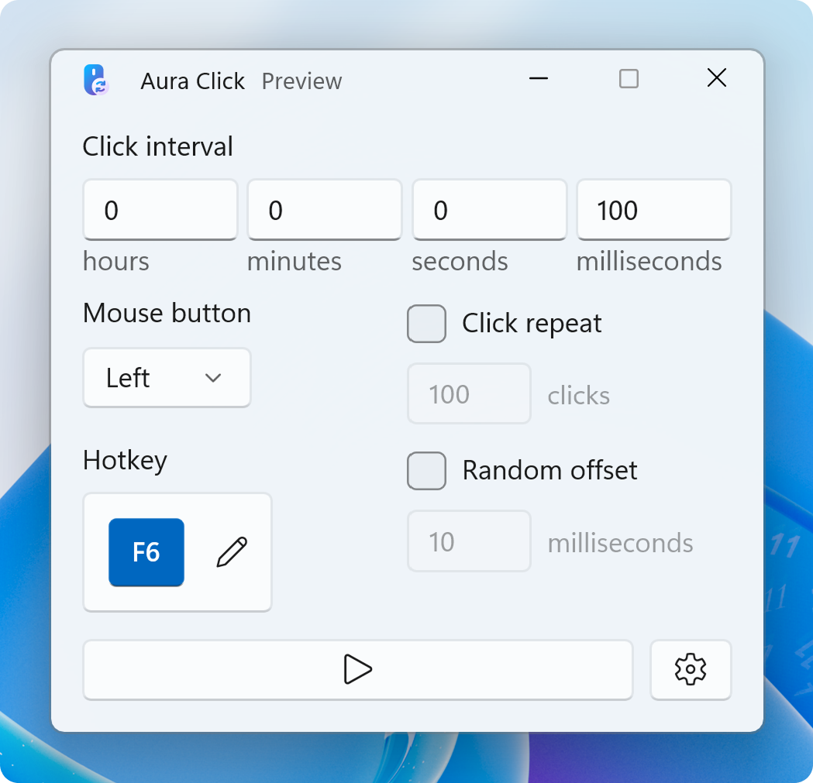

<h1 align="center">
  
  <br>
  Aura Click (Preview)
</h1>

<div align="center">

  [](https://github.com/ryanlua/auraclick/actions/workflows/ci.yml)
  [](https://crowdin.com/project/auraclick)
  [](https://discord.gg/VVSxKCCQ5D)

</div>

> [!IMPORTANT]
> This app is currently in public preview. Share your feedback by creating a new [issue](https://github.com/ryanlua/auraclick/issues).

A modern, high-performance auto clicker for Windows. Automate mouse clicks with a hotkey and customize click intervals, click types, and more.

<p align="center">
  <picture>
    <source media="(prefers-color-scheme: dark)" width="512" srcset="assets/screenshot-dark.png">
    
  </picture>
  <br>
  <br>
  <a href="https://apps.microsoft.com/detail/9NTVRZD0MF7F?referrer=appbadge&mode=full">
    <picture>
      <source media="(prefers-color-scheme: dark)" width="256" srcset="https://get.microsoft.com/images/en-us%20light.svg">
      
    </picture>
  </a>
</p>

## 📦 Installation

### Microsoft Store

You can install Aura Click from the [Microsoft Store's Aura Click page](https://apps.microsoft.com/detail/9NTVRZD0MF7F).

### WinGet

To install Aura Click using the [Windows Package Manager](https://learn.microsoft.com/en-us/windows/package-manager/winget/), it's as simple as running the following command from the command line / PowerShell:

```ps1
winget install --id RyanLuu.AuraClick --source winget
```

### GitHub Releases

To install Aura Click from GitHub Releases by downloading and opening the [latest `AuraClick.appinstaller` file](https://github.com/ryanlua/auraclick/releases/latest/download/AuraClick.appinstaller) and following the installation prompts.

## 💬 Discord Server

Join the [Discord server](https://discord.gg/VVSxKCCQ5D) for support and the latest news including development updates and more.

## 🌐 Translating

Help us translate into more languages! Join our [Crowdin project](https://crowdin.com/project/auraclick) and start contributing translations.

## 👏 Contributing

We welcome contributions from everyone. Before contributing, read the [contribution guidelines](.github/CONTRIBUTING.md).

When you're ready, [make your first contribution](https://github.com/ryanlua/auraclick/contribute) to this repository by tackling an issue.

## 💖 Sponsors

Help support this app by [sponsoring us](https://github.com/sponsors/ryanlua) to support its development and future updates.

## 🪪 License

Aura Click is released under the [GNU General Public License v3.0](COPYING.md).

> Copyright © 2026 Ryan Luu
>
> Aura Click is free software: you can redistribute it and/or modify it under the terms of the GNU General Public License as published by the Free Software Foundation, either version 3 of the License, or (at your option) any later version.
>
> Aura Click is distributed in the hope that it will be useful, but WITHOUT ANY WARRANTY; without even the implied warranty of MERCHANTABILITY or FITNESS FOR A PARTICULAR PURPOSE. See the GNU General Public License for more details.
>
> You should have received a copy of the GNU General Public License along with Aura Click. If not, see <https://www.gnu.org/licenses/>.
